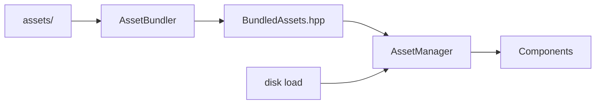

# Asset management

`Engine::AssetManager` is a global resource that owns decoded sprites, sounds, music, and
fonts. Components store **ids and paths**, not loaded objects; the manager turns ids into
resources.



---

## Getting the manager

A plugin normally creates it for you (`SpritePlugin` and `AudioPlugin` both guard with
`HasResource`):

```cpp
auto& assets = registry.GetResource<Engine::AssetManager>();
```

If nothing has created it yet:

```cpp
auto& assets = registry.AddResource<Engine::AssetManager>();
```

---

## Bundled assets

The `AssetBundler` tool compiles the project's `assets/` folder into a generated header.
Bundled games cannot ship without their assets, and startup avoids disk I/O.

```cpp
#include "BundledAssets.hpp"

auto& assets = registry.GetResource<Engine::AssetManager>();
BundledAssets::RegisterAssets(assets);
```

Ids are the relative file names under `assets/` (`player.png`, `laser.wav`).

---

## Loading from disk

Useful for tools, mods, or very large optional packs.

```cpp
assets.LoadSprite("player", "assets/player.png");
assets.LoadSound("explosion", "assets/boom.wav");
assets.LoadMusic("bgm", "assets/music.mp3", true); // true = loop

auto sprite = assets.GetSprite("player");
auto sound = assets.GetSound("explosion");
auto music = assets.GetMusic("bgm");
```

`Get*` throws `ErrorAsset` if the id is not loaded. Unload explicitly when you are done with
a large asset:

```cpp
assets.UnloadSprite("player");
assets.UnloadSound("explosion");
assets.UnloadMusic("bgm");
```

---

## Paths

Asset paths in components are **project-relative**. The editor and the built game resolve
them against the project folder, so the same `.scene` works in both. Do not store absolute
paths in a component; they break on another machine and inside bundles.

See `Assets/ProjectPaths.hpp` for the resolution helpers.

---

## What lives where

| Asset | Loaded by | Referenced from |
|---|---|---|
| Sprites | `LoadSprite` / bundler | `SpriteComponent.assetPath` |
| Sounds | `LoadSound` / bundler | `AudioSource.assetId` |
| Music | `LoadMusic` / bundler | `AudioSource.assetId` |
| Fonts | `LoadFontFromMemory` | `Text.font` |

See also: [Sprites](sprites.md) · [Audio](audio.md) · [Text](text.md).
