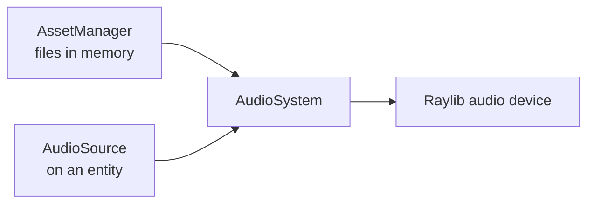

# Audio

Audio is fully ECS-driven: you never call `Play()` from gameplay code. You set fields on an
`AudioSource` component and let `AudioSystem` talk to the device.



- **`AssetManager`** (resource) owns the decoded audio files.
- **`AudioSource`** (component) is the request: asset id, sound or music, play/stop flags.
- **`AudioSystem`** consumes requests and manages overlapping playback.
- **`AudioPlugin`** registers all of the above.

---

## Setup

```cpp
#include "Plugins/AudioPlugin.hpp"

Engine::AudioPlugin audioPlugin;
audioPlugin.Init(app.GetRegistry());
```

That registers `AssetManager` (if missing), `AudioSource`, and `AudioSystem`, and opens the
audio device.

---

## Loading audio

There are two asset kinds:

| Kind | Use for | Behaviour |
|---|---|---|
| **Sound** | Lasers, hits, explosions | Decoded into RAM, can overlap many times |
| **Music** | Background tracks | Streamed from disk, one playhead per asset |

### From the bundled assets (recommended)

The `AssetBundler` turns `assets/` into a generated C++ header at build time, so the
executable ships with its audio and cannot lose a file at runtime.

```cpp
#include "BundledAssets.hpp"

auto& assets = app.GetRegistry().GetResource<Engine::AssetManager>();
BundledAssets::RegisterAssets(assets);

// Asset ids are the relative file names.
if (assets.GetAllMusic().contains("music.mp3")) {
    assets.GetMusic("music.mp3").SetLooping(true);
}
```

### From disk

```cpp
auto& assets = app.GetRegistry().GetResource<Engine::AssetManager>();

assets.LoadMusic("bgm_level1", "assets/music.mp3", true); // true = loop
assets.LoadSound("laser_pew", "assets/laser.wav");
```

Prefer bundling for released games and disk loading for large, optional tracks.

---

## Playing a sound

Attach the component and set `shouldPlay`. `AudioSystem` clears the flag when it has handled
the request.

```cpp
Engine::Entity laser = registry.CreateEntity();

Engine::AudioSource audio;
audio.assetId = "laser_pew";
audio.isMusic = false;
audio.shouldPlay = true;

registry.AddComponent(laser, audio);
```

Or trigger it from a gameplay system by flipping the field:

```cpp
class PlayerSystem : public Engine::System {
  public:
    void Update(Engine::Registry& registry, float dt) override {
        auto& inputs = registry.GetResource<Engine::InputManager>();

        for (auto& [entity, input] : *registry.GetComponentArray<Input>()) {
            if (!registry.HasComponent<AudioSource>(entity)) {
                continue;
            }

            auto* controller = inputs.GetController(input.playerIdx);
            if (controller != nullptr && controller->isActionActive("SHOOT")) {
                registry.GetComponent<AudioSource>(entity).shouldPlay = true;
            }
        }
    }
};
```

This is the data-oriented pattern: gameplay mutates data, the audio system observes it.

---

## Background music

Music uses the same component with `isMusic = true`:

```cpp
Engine::AudioSource bgm;
bgm.assetId = "bgm_level1";
bgm.isMusic = true;
bgm.shouldPlay = true;

registry.AddComponent(levelEntity, bgm);
```

Stop it by setting `shouldStop`:

```cpp
registry.GetComponent<Engine::AudioSource>(levelEntity).shouldStop = true;
```

`AudioSystem` updates the streaming buffer every frame while a track plays.

---

## Overlapping sounds

You do not manage voices. If 50 entities request `laser_pew` on the same frame, the asset
manager hands out 50 lightweight aliases and `AudioSystem` mixes them, while keeping one
decoded copy of the file in RAM.

The alias list is pruned automatically as sounds finish.

---

## Troubleshooting

| Symptom | Likely cause |
|---|---|
| Nothing plays | `AudioPlugin::Init()` was not called, or the device failed to open |
| `GetResource` throws | `AudioPlugin` was skipped and `AssetManager` was never registered |
| Wrong asset id | Bundled ids are relative paths (`laser.wav`, not `assets/laser.wav`) |
| Music restarts every frame | `shouldPlay` is being set continuously instead of once |
| Sound cut off | The entity or its `AudioSource` was destroyed; aliases keep playing, entities do not |

---

See also: [Asset management](assets.md) · [Systems](systems.md) · [Plugins](plugins.md).
