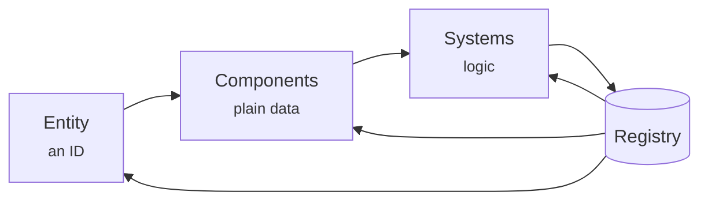
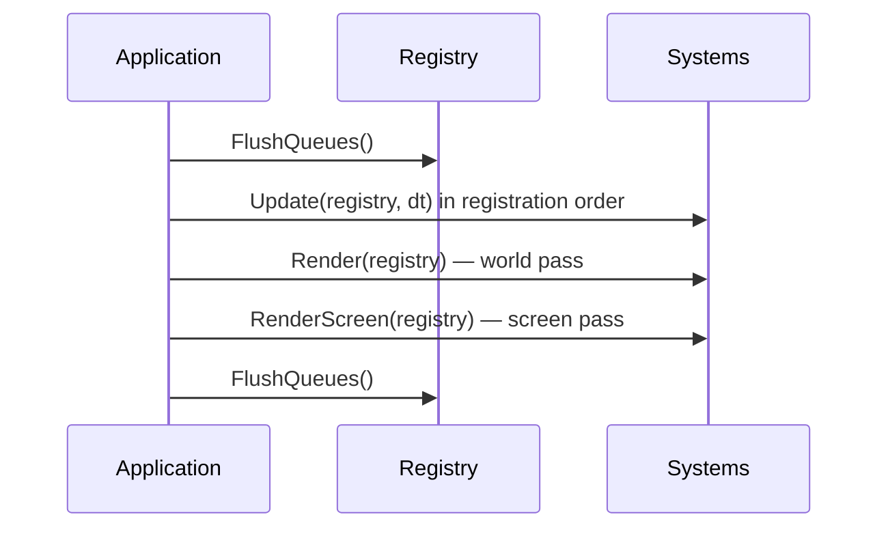

# ECS architecture

The R-Type Engine is built on a small, explicit **Entity Component System**. The whole
architecture fits in one sentence: **entities are IDs, components are data, systems are
behaviour, and the registry owns all three.**



This page explains the model and the `Registry` API. For hands-on recipes, see
[Components](components.md), [Systems](systems.md), and [Plugins](plugins.md).

---

## Entities

An `Engine::Entity` is just an identifier. It has no data and no methods.

```cpp
Engine::Entity player = registry.CreateEntity();
```

`CreateEntity()` already attaches a `Position` and a `Rotation`, so a fresh entity can be
placed and drawn immediately. Entities are cheap to create and destroy; the registry keeps
IDs stable for the lifetime of the entity.

Destroying an entity destroys its whole subtree:

```cpp
registry.QueueDestroyEntity(enemy);   // deferred, safe inside a system
registry.DestroyEntity(enemy);        // immediate
```

Use `QueueDestroyEntity()` from gameplay code. `QueueDestroyEntity` only records the request;
the registry flushes it at the end of the frame, so iterating a component array never gets
invalidated mid-loop.

---

## Components

A component is a plain C++ `struct` with public fields. It contains **only state**.

```cpp
struct Health {
    int current = 100;
    int max = 100;
    bool invincible = false;
};
```

The registry stores every component type in its own contiguous `ComponentArray<T>`. All
`Health` components live next to each other, which keeps iteration cache-friendly. Components
must be registered before use:

```cpp
registry.RegisterComponent<Health>();
```

Some components are registered by the registry itself (`Position`, `Rotation`, `ScreenSpace`).
Plugins register the rest. See [Components](components.md) for the full list and best practices.

---

## Systems

A system is a class that inherits from `Engine::System` and overrides one or more passes:

```cpp
class DamageSystem : public Engine::System {
  public:
    void Update(Engine::Registry& registry, float dt) override {
        for (Engine::Entity entity : m_Entities) {
            auto& health = registry.GetComponent<Health>(entity);
            if (health.current <= 0) {
                registry.QueueDestroyEntity(entity);
            }
        }
    }
};
```

The important part is `m_Entities`: the registry fills it automatically with every entity that
has the components the system declared an interest in. A system runs **once per frame** and
loops over that set; it does not run per entity.

The three passes are:

| Pass | When it runs | Use it for |
|---|---|---|
| `Update(registry, dt)` | Once per frame, before rendering | Simulation, input, collisions |
| `Render(registry)` | Inside the active camera | World-space drawing |
| `RenderScreen(registry)` | After the world, in window pixels | HUD, menus, debug overlays |

Registration order matters: systems update in the order they were registered. That is why, for
example, the hierarchy plugin is registered before the position plugin. See [Systems](systems.md).

---

## The registry

`Engine::Registry` is the coordinator. It owns:

1. **Entity allocation** — unique IDs and deferred destruction.
2. **Component storage** — one `ComponentArray<T>` per registered type.
3. **System storage and ordering** — update order and render order.
4. **Resources** — singleton-like data such as `AssetManager` or `InputManager`.

It is available from the application:

```cpp
Engine::Application app(config);
Engine::Registry& registry = app.GetRegistry();
```

### Creating and populating an entity

```cpp
Engine::Entity enemy = registry.CreateEntity();

registry.AddComponent(enemy, Engine::Position(400.0f, 120.0f));
registry.AddComponent(enemy, Engine::Health{ .current = 3, .max = 3 });

registry.RemoveComponent<Engine::Health>(enemy);
bool alive = registry.HasComponent<Engine::Health>(enemy);
```

`CreateEntity()` is the normal path. `AddComponent` inserts or replaces the component data for
that entity.

### Resources

Resources are values shared by the whole game: asset tables, input state, project paths,
network host state. They are not attached to entities.

```cpp
auto& assets = registry.AddResource<Engine::AssetManager>();
auto& input  = registry.GetResource<Engine::InputManager>();

if (registry.HasResource<Engine::InputManager>()) {
    // ...
}
```

Use a resource for anything that is **one per game**, and a component for anything that is
**one per entity**.

---

## A frame, end to end



The takeaway: your gameplay code only mutates components and queues destruction. The
application owns the loop and the order in which systems see the world.

---

## Rules of thumb

- **Keep components dumb.** No methods, no pointers to other components, no ownership.
- **Prefer several small components** over one large one; systems only subscribe to what they
  read.
- **Never destroy an entity directly from a system.** Queue it.
- **Register systems deliberately.** The order is the update order.
- **Bundle registration in a plugin.** If a feature needs a component, a system, and a
  resource, it should be one `Init()` call.

Next: [Components](components.md) → [Systems](systems.md) → [Plugins](plugins.md).
