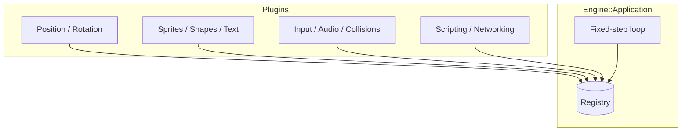

# Engine

The engine is a C++23 library plus a set of plugins. You compose it in `main()`: create an
application, install the plugins you need, spawn entities, run.



---

## The model

<div class="grid cards" markdown>

-   **Entities**

    ---

    An ID. No data, no methods. `CreateEntity()` allocates one and attaches a default
    `Position` and `Rotation`.

    [:octicons-arrow-right-24: ECS architecture](ecs.md)

-   **Components**

    ---

    Plain structs of data, stored contiguously per type. No logic, no ownership.

    [:octicons-arrow-right-24: Components](components.md)

-   **Systems**

    ---

    Classes that read and write components once per frame. Registration order is update
    order.

    [:octicons-arrow-right-24: Systems](systems.md)

-   **Plugins**

    ---

    Bundles that register components, systems, and resources behind one `Init()` call.

    [:octicons-arrow-right-24: Plugins](plugins.md)

</div>

---

## Guides

| Subsystem | Page |
|---|---|
| Assets and the bundler | [Asset management](assets.md) |
| Sprites and layering | [Sprites](sprites.md) |
| Shapes and primitives | [ECS architecture → built-in components](components.md#built-in-components) |
| Text and fonts | [Text](text.md) |
| Camera, follow, shake | [Camera](camera.md) |
| Collisions and triggers | [Collisions](collisions.md) |
| Input actions and devices | [Input](input.md) |
| Audio and music | [Audio](audio.md) |
| State machines | [State management](states.md) |
| Server-authoritative multiplayer | [Networking](networking.md) |

---

## A minimal `main()`

```cpp
#include "Core/Application.hpp"
#include "Plugins/PositionPlugin.hpp"
#include "Plugins/ShapePlugin.hpp"

int main() {
    Engine::ApplicationConfig config;
    config.windowTitle = "Sandbox";

    Engine::Application app(config);

    Engine::PositionPlugin position;
    position.Init(app.GetRegistry());

    Engine::ShapePlugin shapes;
    shapes.Init(app.GetRegistry());

    // Spawn entities, attach components, register systems...

    app.Run();
    return 0;
}
```

See [Your first game](../start/first-game.md) for the rest of this example.

---

## API reference

The Doxygen-generated reference lives under **API** in the top navigation. It is organised
by class and file; use it when you know the symbol you want. The guides here explain the
intended workflow and the ordering constraints that the headers cannot express.
