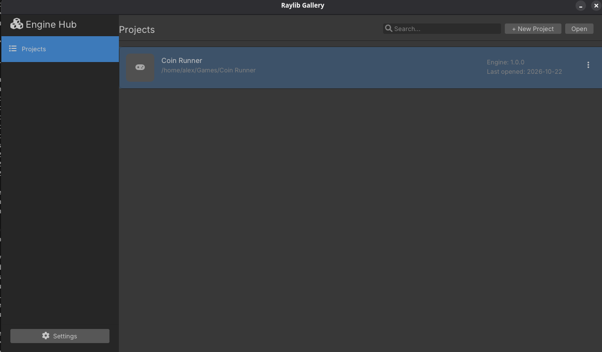
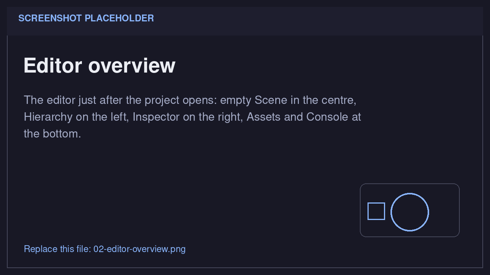
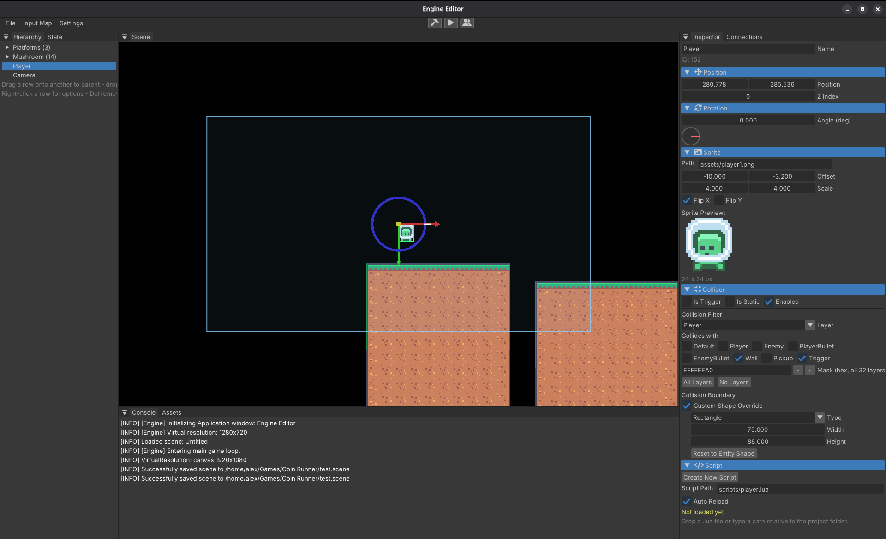
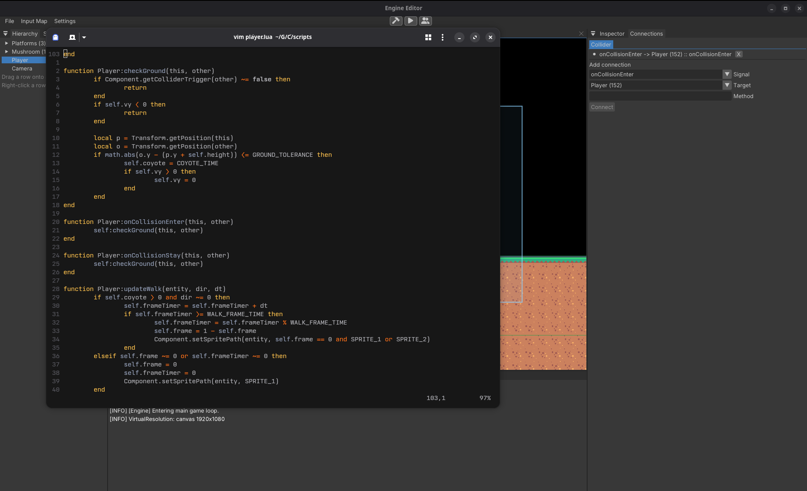
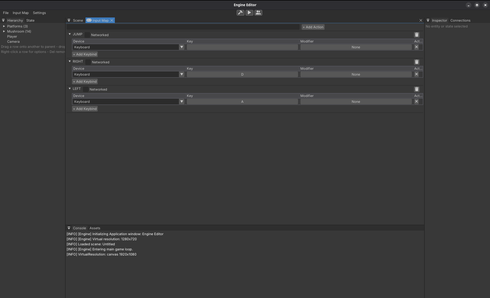

# Your first game in the editor

This page is the editor's quick start, not a full game tutorial. It gives you
the pieces every game is made of and shows how to drive them. Once you know
these tools, the game is up to you.

You will create a project, add an entity, give it a sprite, a collider, and a
script, bind two actions, and run it. No C++ is involved.

## 1. Create a project

1. Start the editor. It opens the **Project Gallery**.
2. Click **+ New Project**.
3. Fill in the dialog:

    | Field | Value |
    |---|---|
    | **Project Name** | `My Game` |
    | **Description** | Anything you like |
    | **Path** | An empty folder, for example `~/games/my-game` |

    Use **Browse...** if you prefer to pick the folder.
4. Click **Create**, then click the new project card. The first time you open
   it, Lucky creates `test.scene` and an `assets/` folder and shows the editor.
   A `scripts/` folder appears when you create your first script.

    

!!! warning "Use a new folder"
    Do not point a new project at an existing project such as `R-Type/`. If the
    folder already contains a `test.scene`, Lucky opens that scene instead of
    creating a fresh one.

### Ready-made art (optional)

The example uses some sprites from [Kenney Assets](https://kenney.nl/assets/pixel-platformer).

## 2. Know the panels

| Panel | Default position | What it is for |
|---|---|---|
| **Hierarchy** | Left | Create, select, rename, copy and parent entities |
| **Scene** | Center | See the level and drag the selected entity |
| **Inspector** | Right | Add components and edit their values |
| **Assets** | Bottom | Browse the project's files |
| **Console** | Bottom | The editor's own log (not the running game's output) |

The toolbar has **File**, **Input Map** and **Settings** on the left, and three
buttons in the middle: a **hammer** (build), a **play** triangle (run), and a
**multiplayer** button (not needed here).



An **entity** is a numeric id. A **component** is a piece of data attached to it. A name, a sprite, a position, a collider, a script. A **system** is engine code
that reads those components every frame: rendering, collisions, scripts. The
editor is a view over that data.

!!! note "The editor does not run your game"
    The Scene view shows the authored data. Lua only runs in the separate
    process that **Play** starts. Nothing will move until you build, play, and
    click the game window.

## 3. Create an entity with a sprite

1. Right-click empty space in the **Hierarchy** and choose
   **Create Empty Entity**.
2. In the **Inspector**, name it `Player`.
3. Right-click the **Inspector** and choose **Add Sprite**.
4. Drag `player.png` from **Assets → assets/sprites** onto the Sprite's
   **Path** field. The preview shows the image.
5. Set **Position** to `X 100`, `Y 400`. Leave **Z Index** at `0`.

A sprite is only a picture. It draws from `Position + Offset`, at the texture's
native size multiplied by **Scale**. A higher **Z Index** draws in front of a
lower one.

## 4. Give it a collider

1. Right-click the **Inspector** and choose **Add Collider**.
2. In **Collision Boundary**, set **Width** `44`, **Height** `52`  -  the size of
   `player.png`.
3. Leave **Is Trigger** and **Is Static** off.

The collider is a separate boundary. Because this entity has no Shape
component, Add Collider created a **custom boundary** stored inside the
collider. Nothing draws it, so the picture and the physics box are independent.

- **Is Trigger** reports the overlap without blocking anything. Use it for
  pickups, goals, and hit boxes.
- **Is Static** stops the body from being pushed when something hits it. Use it
  for ground and walls.
- **Layer** and **Collides with** decide which colliders interact. The defaults
  interact with everything.


*Screenshot 3  -  Name, Sprite path, Position and the Collider's 44 × 52 boundary.*

## 5. Add a script

1. Right-click the **Inspector** → **Add Script**.
2. Click **Create New Script**, type `player`, and click **Create**.
   Lucky writes `<project folder>/scripts/player.lua` and sets **Script Path**
   to `scripts/player.lua`.
3. Open that file in your text editor and replace the template with:

```lua
local Player = {}

local SPEED = 240

function Player:onCreate(entity)
    self.entity = entity
end

function Player:onUpdate(entity, dt)
    local dir = 0
    if Controller.isActionActive("left") then dir = dir - 1 end
    if Controller.isActionActive("right") then dir = dir + 1 end
    Transform.translate(entity, dir * SPEED * dt, 0)
end

return Player
```

What the pieces mean:

- `local Player = {}` is this script's own table; `return Player` hands it to the
  engine. Each `ScriptComponent` gets its own table, so `self` is never shared
  between entities.
- `onCreate(entity)` runs **once**, when the script is loaded.
- `onUpdate(entity, dt)` runs **every frame**. `dt` is in **seconds**, so
  `SPEED * dt` is "240 pixels per second, for this frame".
- `Controller.isActionActive("left")` is true while that action is held. The
  names come from the Input Map.
- `Transform.translate(entity, dx, dy)` adds to the entity's Position.

The same pattern extends to the rest of a platformer:

- **Gravity:** keep `self.vy`, add `GRAVITY * dt`, then
  `Transform.translate(entity, 0, self.vy * dt)`.
- **Jumping:** set `self.vy = -JUMP_SPEED` while a `jump` action is freshly
  pressed and `self.grounded` is true.
- **Ground:** call `Component.connect(entity, "onCollisionEnter", entity,
  "onCollisionEnter")` (and `onCollisionStay`) and set `self.grounded` when the
  other collider's top is at your feet.
- **Animation:** add a second frame such as `player_2.png` to
  `assets/sprites/`, swap textures with
  `Component.setSpritePath(entity, path)`, and mirror with
  `Component.setSpriteFlip(entity, true)`.

The callback names are `onCreate(entity)`, `onUpdate(entity, dt)` and
`onCollisionEnter/Stay/Exit(this, other)`.

!!! note "Two things that surprise people"
    - The editor never runs Lua, so the Script section stays **Not loaded yet**.
      That status changes only in the running game.
    - A Lua edit does not need a rebuild: save the file, close the game window,
      and click **Play** again.


*Screenshot 4  -  Script Path `scripts/player.lua` and the editor's Not loaded yet status.*

## 6. Bind the controls

The script asks for named actions, not key codes.

1. Open **Input Map** from the menu bar. If the Scene is still on top, click the
   **Input Map** tab next to it.
2. Type `left` in the field at the top and click **+ Add Action**.
3. Expand `left`, click **+ Add Keybind**, then click the **Key** button (it says
   **None**) and press the **Left** arrow key.
4. Repeat for `right` → Right arrow. (Add `jump` → Space when you add jumping.)


*Screenshot 5  -  the `left` and `right` actions with their keys.*

Action names are **case-sensitive**. `left`, `Left` and `LEFT` are three
different actions. The Input Map is stored in the scene, but it is baked into
the game launcher, so changing it needs a new build.

## 7. Build and play

1. **Save the scene** with `Ctrl+S` (or **File → Save Scene**).
2. Click the **hammer** in the toolbar. The first build compiles the engine and
   can take a few minutes; hover the hammer to see the progress.
3. When the hammer stops showing a percentage, click the **play** triangle.
   Lucky saves the scene again and starts the game in a separate window.
4. **Click the game window** to give it keyboard focus. The player should slide
   left and right with the arrow keys.

Adding or editing entities, sprites, colliders and Lua files does **not** need a
rebuild: the game reads `test.scene`, the assets and the scripts when it starts.
Changing the **Input Map** or the **window settings** does, because they are
compiled into the launcher.

## 8. What the editor stores

The scene is data. Everything you set in the Inspector becomes a component:

| What you see | Stored as |
|---|---|
| Name field | A `Name` component |
| Sprite section | A `SpriteComponent` (path, offset, scale) |
| Position section | A `Position` component (x, y, and Z Index) |
| Collider section | A `ColliderComponent` (its own boundary, flags, layer) |
| Script section | A `ScriptComponent` (the script path) |

The build writes a small launcher into `<project folder>/main.cpp`, compiles it
with the engine, and copies the executable next to `test.scene`. Play saves the
scene and runs that executable with the **project folder as the working
directory**, which is why `assets/...` and `scripts/...` paths are project
relative.

## 9. If something goes wrong

| Symptom | Likely cause and fix |
|---|---|
| A sprite is invisible or a white box | The **Path** is wrong or the file is missing. Check `<project>/assets/sprites/...`, click **Refresh Folder**, and drag the file onto **Path** again. |
| Nothing moves | Action names must match exactly, including case. Check the **Script Path**, save the file, and click **Play** again. |
| The entity falls through the floor | It needs a **Collider** with **Enabled** on, and its **Collision Boundary** must cover the entity. The floor's collider must be **Is Static** and not a trigger. |
| The ground moves when I land on it | Turn **Is Static** on for the ground's collider. |
| **Play** does nothing | No executable was produced. Click the **hammer**, wait for the build to finish, then Play again. Launch the editor from the repository root so it can find `CMakeLists.txt`. |
| Lua errors are invisible | Launch the editor from a terminal. The running game inherits that terminal, so `[ScriptSystem]` errors are printed there; the editor Console only shows editor logs. |
| The Script section says "Not loaded yet" | That is normal in the editor. It changes only in the game. |

## Next steps

- [Core concepts](concepts.md)  -  entities, components, systems and scenes.
- [Lua API reference](../lua/index.md)  -  every function available to a
  script.
- [Lua scripting](../engine/scripting.md)  -  the script lifecycle and signals.
- [Your first game in C++](first-game-engine.md)  -  when Lua is not enough.
