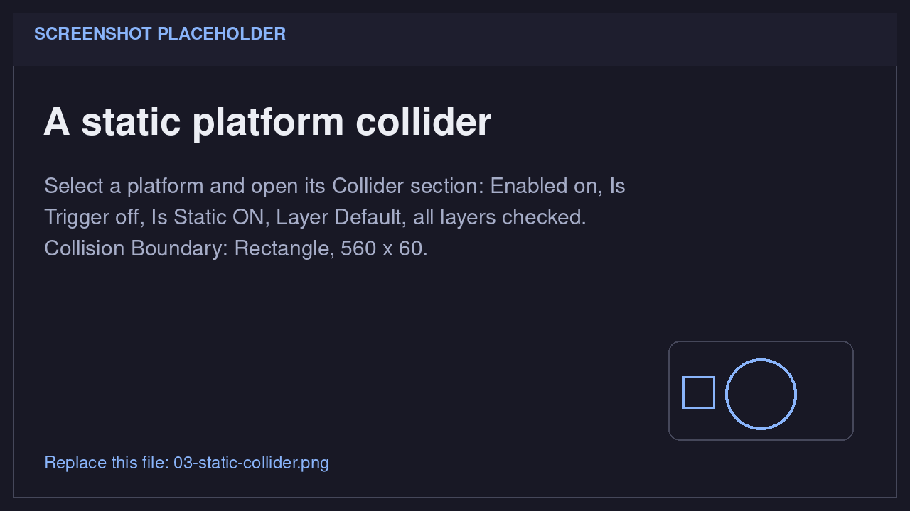
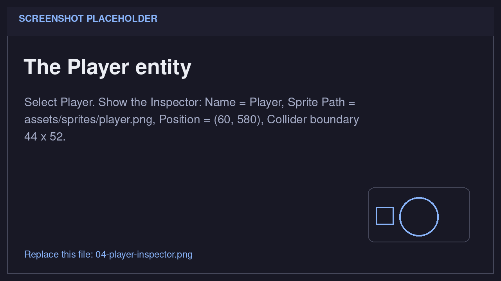
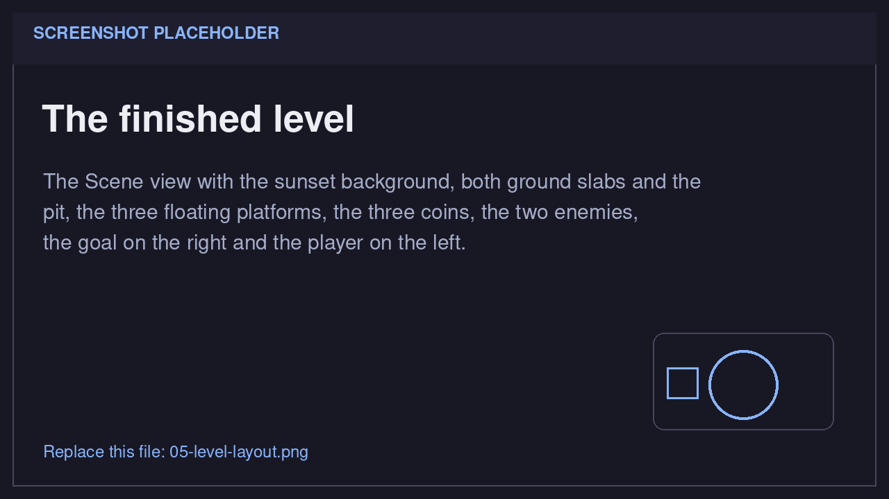
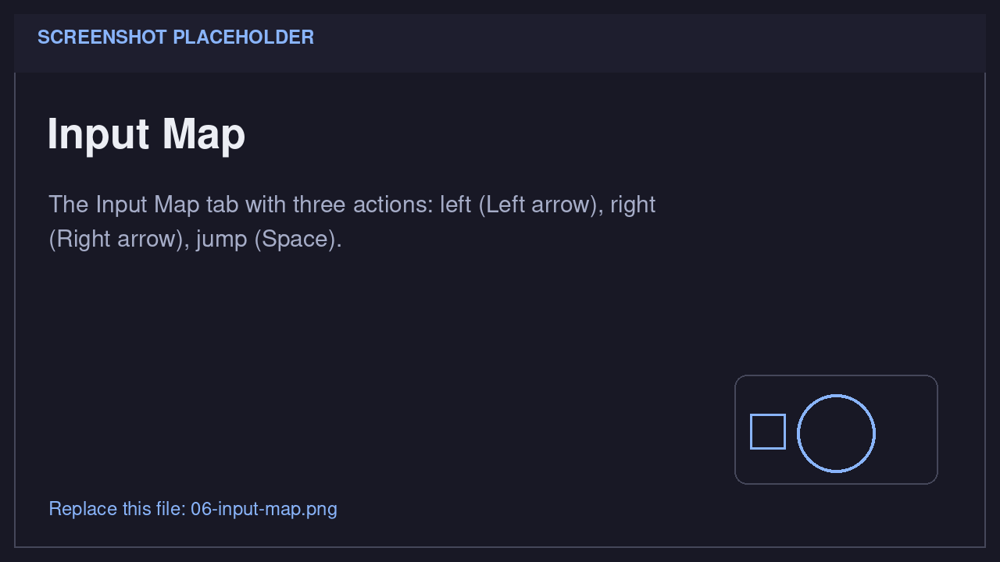
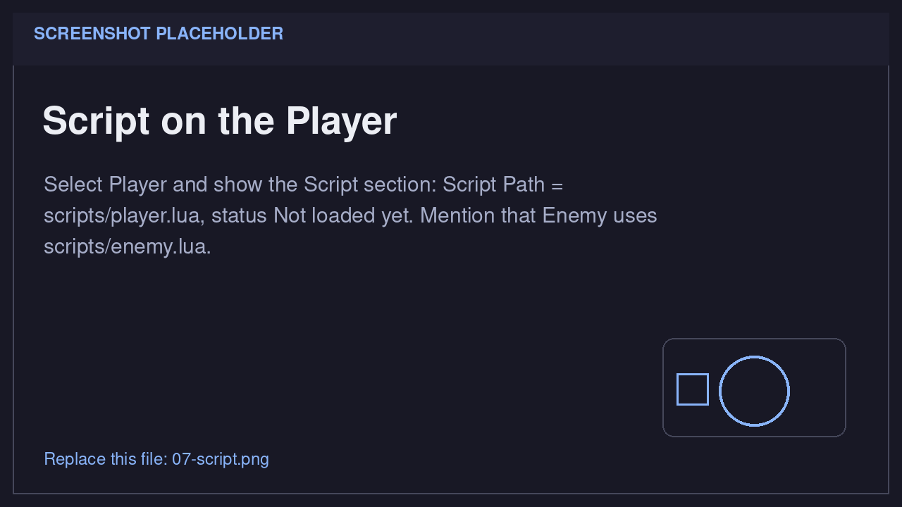
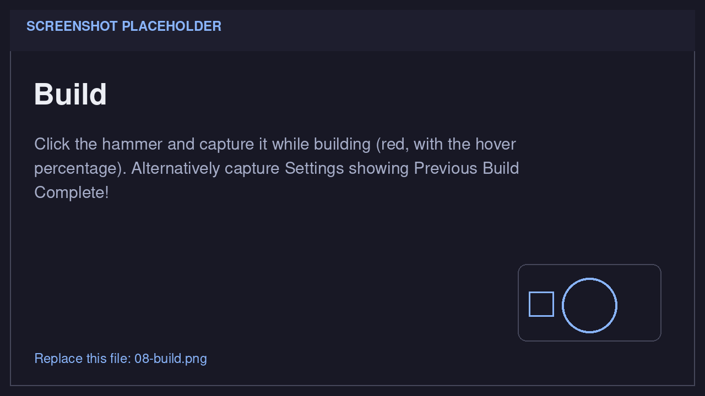
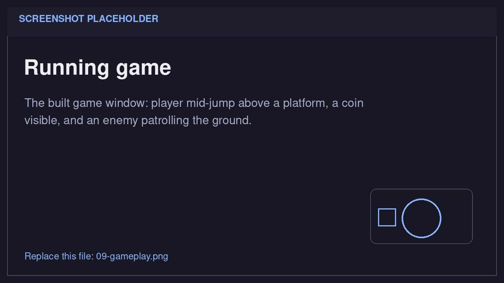
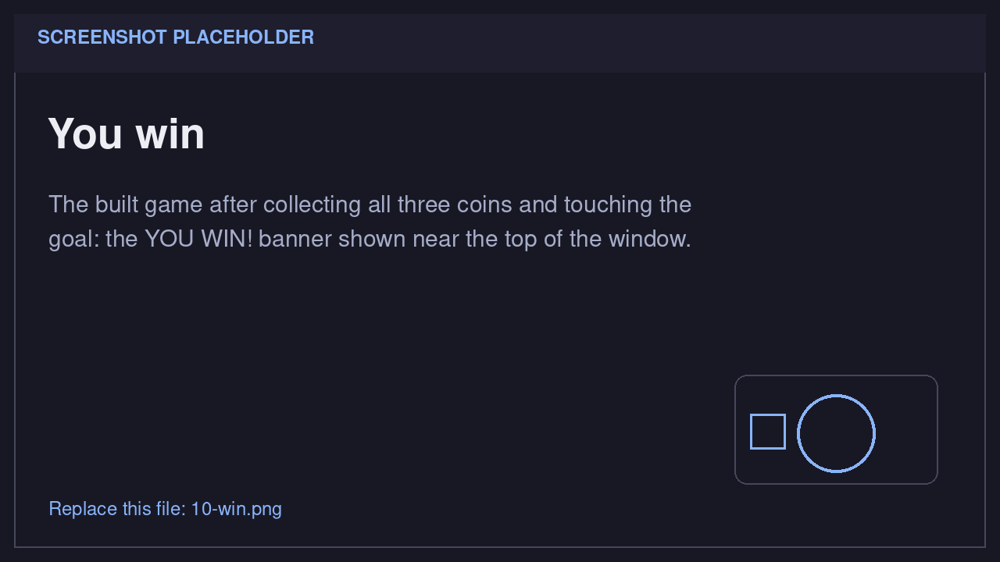

# Your first game in the editor

Build **Coin Runner**, a small side-scrolling platformer in the spirit of the
classic 8-bit ones, without writing a line of C++. You will lay out a level,
give the player gravity and a jump, add coins and patrolling enemies, and finish
with a goal. Everything on this page is a click in Lucky (the editor), a file
you copy into the project, or a Lua file.

By the end you will have:

- a player that runs, jumps, and lands on platforms;
- a pit, floating platforms, and three collectible coins;
- two patrolling enemies you can stomp or avoid;
- a goal flag and a **YOU WIN!** banner.

The game uses a small pixel-art sprite pack, so you do not need to draw
anything. Every object is a sprite; the colliders are separate invisible
boundaries.

## 1. Create the project

1. Start the editor. It opens the **Project Gallery**.
2. Click **+ New Project**.
3. Fill in the dialog:

    | Field | Value |
    |---|---|
    | **Project Name** | `Coin Runner` |
    | **Description** | Anything you like |
    | **Path** | An empty folder, for example `~/games/coin-runner` |

    Use **Browse...** if you prefer to pick the folder.
4. Click **Create**. The dialog closes and the project appears in the gallery.
5. Click the project card. The first time you open the project, Lucky creates
   `test.scene` and an `assets/` folder, then shows the editor. The `scripts/`
   folder appears later, when you create your first script.

    
    *Screenshot 1 — the Project Gallery with the **Coin Runner** card.*

!!! warning "Use a new folder"
    Do not point a new project at an existing project such as `R-Type/`. If the
    folder already contains a `test.scene`, Lucky opens that scene instead of
    creating a fresh one.

### Get the sprite pack

The sprite pack is part of this documentation:

[Download the sprite pack](../assets/first-game-editor/coin-runner-sprites.zip)

If you have the repository, the same files are in
`Documentation/docs/assets/first-game-editor/sprites/`.

1. Extract or copy the `sprites` folder into your project's `assets` folder.
   You should end up with files such as `<project>/assets/sprites/player.png`.
2. In the editor, open the **Assets** panel at the bottom and click
   **Refresh Folder**.
3. Expand `assets/sprites`. You will drag these files onto **Sprite** components
   as you build the level.

| File | Size | Used for |
|---|---|---|
| `background.png` | 1280 × 720 | The sunset backdrop |
| `ground_a.png` | 560 × 60 | Ground A |
| `ground_b.png` | 580 × 60 | Ground B |
| `platform_1.png` | 160 × 24 | Floating platform 1 |
| `platform_2.png` | 180 × 24 | Floating platform 2 |
| `platform_3.png` | 160 × 24 | Floating platform 3 |
| `player.png` | 44 × 52 | The player |
| `coin.png` | 24 × 24 | All three coins |
| `enemy.png` | 36 × 36 | Both enemies |
| `goal.png` | 40 × 140 | The goal flag |
| `win_banner.png` | 420 × 96 | The **YOU WIN!** banner |

!!! note "A sprite is a picture, a collider is a boundary"
    Adding a **Sprite** does not give the entity a collider, and adding a
    **Collider** does not add a visible shape. The collider has its own
    **Collision Boundary**, which you set to match the picture. This is why the
    invisible collision boxes in this tutorial never show up in the game.

### A quick look around

The panels are docked and can be resized by dragging the splitters:

| Panel | Default position | What you use it for |
|---|---|---|
| **Hierarchy** | Left | Create, select, copy, rename and parent entities |
| **Scene** | Center | See the game view and drag the selected entity |
| **Inspector** | Right | Name the entity, add components, edit their values |
| **Assets** | Bottom | Browse the project's files |
| **Console** | Bottom | The editor's own log (not the running game's output) |

The bar at the top has **File**, **Input Map**, and **Settings** on the left,
and three icon buttons in the middle: a **hammer** (build the game), a **play**
triangle (run the built game), and a **multiplayer** button (not needed here).


*Screenshot 2 — the empty project: Hierarchy, Scene, Inspector, Assets, Console.*

!!! note "The editor does not run your game inside its own window"
    The Scene view shows the authored data. Lua only runs in the separate game
    process that **Play** starts. So nothing will move until you build, play,
    and click the game window.

## 2. Lay out the level

The game canvas is **1280 × 720**. For a sprite, **Position is the top-left
corner of the picture**. A rectangle collider also starts at its Position; a
circle collider is centered on it. The **Z Index** in the Position section
decides the draw order: lower numbers are drawn first, behind higher ones.

### The background

1. Right-click empty space in the **Hierarchy** and choose
   **Create Empty Entity**.
2. In the **Inspector**, name it `Background`.
3. Right-click the **Inspector** and choose **Add Sprite**.
4. Drag `background.png` from **Assets → assets/sprites** onto the Sprite's
   **Path** field. The preview shows the sunset.
5. Set **Position** to `X 0`, `Y 0`, and **Z Index** to `-10`.

The background has no collider. The negative Z Index keeps it behind every
other sprite.

### The ground

1. **Create Empty Entity** and name it `Platform`.
2. Add a **Sprite** and set its **Path** to `ground_a.png`.
3. Set **Position** to `X 0`, `Y 660`. The sprite is 560 × 60, so it covers the
   bottom-left of the canvas.
4. Right-click the **Inspector** and choose **Add Collider**.
5. Turn **Is Static** **on**.
6. In **Collision Boundary**, leave **Type** on `Rectangle` and set **Width**
   `560`, **Height** `60`.

Because this entity has no Shape component, the collider created its own
boundary for you. It is not drawn.

!!! danger "Static platforms are not optional"
    When two non-static colliders overlap, the collision system pushes both of
    them apart. If the ground is not static, the player landing on it would shove
    the ground around. **Is Static** keeps the level still and moves only the
    player.


*Screenshot 3 — a platform's **Collider**: **Is Static on**, and a **Collision Boundary** of 560 × 60.*

### The rest of the platforms

Select `Platform` and press **Ctrl+C**, then **Ctrl+V** (or use **Copy** /
**Paste** from its right-click menu). The copy is selected and gets the next
free name. Replace its sprite, position, and boundary with the next row of the
table:

| Piece | Name (automatic) | Sprite | Position (X, Y) | Boundary |
|---|---|---|---|---|
| Ground A | `Platform` | `ground_a.png` | 0, 660 | 560 × 60 |
| Ground B | `Platform(1)` | `ground_b.png` | 700, 660 | 580 × 60 |
| Platform 1 | `Platform(2)` | `platform_1.png` | 300, 560 | 160 × 24 |
| Platform 2 | `Platform(3)` | `platform_2.png` | 520, 460 | 180 × 24 |
| Platform 3 | `Platform(4)` | `platform_3.png` | 760, 360 | 160 × 24 |

To change a copy, drag the new sprite onto its **Path** field, edit
**Position**, then edit **Width** / **Height** in **Collision Boundary**. The
static collider and the trigger setting are copied with the entity.

That leaves a **140-pixel pit** between x = 560 and x = 700, and three floating
platforms, each 100 pixels above the previous one.

!!! note "Pasted names get a suffix"
    Pasting renames copies to `Platform(1)`, `Platform(2)`, and so on. The
    scripts later match the **leading word** of the name, so you do not need to
    rename anything. Every platform still counts as a platform.

## 3. Add the player

1. **Create Empty Entity** and name it `Player`.
2. Add a **Sprite** and set its **Path** to `player.png`.
3. Set **Position** to `X 60`, `Y 580`.
4. Add a **Collider**. Leave **Is Trigger** and **Is Static** **off**.
5. In **Collision Boundary**, set **Width** `44`, **Height** `52`.

The sprite is 44 × 52, so the boundary matches it exactly. The player starts 28
pixels above the ground (580 + 52 = 632, and the ground top is 660), so it will
drop a little and land when the game starts.


*Screenshot 4 — the **Player**: sprite `assets/sprites/player.png`, Position (60, 580), boundary 44 × 52.*

## 4. Add the coins

1. **Create Empty Entity** and name it `Coin`.
2. Add a **Sprite** and set its **Path** to `coin.png`.
3. Set the Sprite **Offset** to `X -12`, `Y -12`.

    A sprite is drawn from its top-left corner, but a circle collider is centered
    on the Position. The coin is 24 × 24, so an offset of half its size centers
    the picture on the same point the circle uses.

4. Set **Position** to `X 380`, `Y 510`.
5. Add a **Collider** and turn **Is Trigger** **on**.
6. In **Collision Boundary**, set **Type** to `Circle` and **Radius** to `12`.

Select `Coin`, copy it twice, and move the copies:

| Coin | Name (automatic) | Position (X, Y) |
|---|---|---|
| Above Platform 1 | `Coin` | 380, 510 |
| Above Platform 2 | `Coin(1)` | 610, 410 |
| Above Platform 3 | `Coin(2)` | 840, 310 |

The copies keep the `(-12, -12)` offset and the circle boundary.

## 5. Add the enemies

1. **Create Empty Entity** and name it `Enemy`.
2. Add a **Sprite** and set its **Path** to `enemy.png`.
3. Set **Position** to `X 180`, `Y 624`. The sprite is 36 × 36, so its bottom
   sits exactly on Ground A (624 + 36 = 660).
4. Add a **Collider** and turn **Is Trigger** **on**.
5. In **Collision Boundary**, keep `Rectangle` and set **Width** `36`,
   **Height** `36`.
6. Right-click the **Inspector** → **Add Script**, click **Create New Script**,
   type `enemy`, and click **Create**. This writes `scripts/enemy.lua` and sets
   **Script Path** to `scripts/enemy.lua`. We will fill the file in later.
7. Copy the enemy and move the copy to `X 1050`, `Y 624`. The copy keeps the
   same script path and gets the name `Enemy(1)`.

| Enemy | Name (automatic) | Position (X, Y) | Patrols |
|---|---|---|---|
| On Ground A | `Enemy` | 180, 624 | x = 100 to 260 |
| On Ground B | `Enemy(1)` | 1050, 624 | x = 970 to 1130 |

## 6. Add the goal and the win banner

### The goal

1. **Create Empty Entity** and name it `Goal`.
2. Add a **Sprite** and set its **Path** to `goal.png`.
3. Set **Position** to `X 1200`, `Y 520`. The sprite is 40 × 140, so it stands
   on Ground B (520 + 140 = 660).
4. Add a **Collider** and turn **Is Trigger** **on**.
5. In **Collision Boundary**, keep `Rectangle` and set **Width** `40`,
   **Height** `140`.

### The win banner

1. **Create Empty Entity** and name it `WinBanner`.
2. Add a **Sprite** and set its **Path** to `win_banner.png`.
3. Set **Position** to `X 430`, `Y -120`, and **Z Index** to `10`.

The banner is 420 × 96, so at y = -120 it is completely above the visible
canvas. When the player wins, the script moves it to (430, 110), near the top of
the window. The Z Index of 10 keeps it in front of the level.

### Save the scene

Press **Ctrl+S** (or **File → Save Scene**). Compare your Scene view with the
screenshot below. The names in your Hierarchy may end in `(1)`, `(2)`, and so
on; that is expected.


*Screenshot 5 — the complete level: sunset background, two ground slabs, three floating platforms, three coins, two enemies, the goal (right), and the player (left).*

## 7. Bind the controls

The scripts ask for named actions, not raw key codes. Create three actions:

1. Open **Input Map** from the menu bar. The panel shares the center area with
   the Scene view; if the Scene is still on top, click the **Input Map** tab
   next to it.
2. Type `left` in the text field at the top and click **+ Add Action**.
3. Expand the new `left` row, then click **+ Add Keybind**.
4. A row appears with the columns **Device**, **Key**, **Modifier**, and
   **Actions**. Click the **Key** button (it says **None**) and press the
   **Left** arrow key. The button changes to the key name.
5. Repeat steps 2–4 for the other actions:

    | Action name | Key |
    |---|---|
    | `right` | Right arrow |
    | `jump` | Space |

6. Click the **Scene** tab to go back to the level.


*Screenshot 6 — the three actions and their keys.*

!!! note "Names are strings"
    The action names are matched exactly, including case. The scripts use
    `"left"`, `"right"`, and `"jump"` — all lowercase.

The actions are stored in the scene's configuration. They are read by the game
as **player 1**, so you do not need to assign a player anywhere.

## 8. Build the player script, step by step

Create the file once, then grow it. Select `Player`, right-click the
**Inspector** → **Add Script**, click **Create New Script**, type `player`, and
click **Create**. Lucky writes `<project folder>/scripts/player.lua` and sets
**Script Path** to `scripts/player.lua`.

!!! tip "Build once, then just press Play"
    The first build compiles the engine and takes a few minutes (section 10 has
    the details). Once it is done, editing a Lua file does **not** need a
    rebuild: save the file, close the game window, and click **Play**. So you can
    build now and watch the player gain one ability at a time.

### Step 1 — Move left and right

Open `<project folder>/scripts/player.lua` in your text editor and replace the
generated template with:

```lua
local Player = {}

local MOVE_SPEED = 240

function Player:onCreate(entity)
    self.entity = entity
end

function Player:onUpdate(entity, dt)
    local dir = 0
    if Controller.isActionActive("left") then dir = dir - 1 end
    if Controller.isActionActive("right") then dir = dir + 1 end
    Transform.translate(entity, dir * MOVE_SPEED * dt, 0)
end

return Player
```

What each part does:

- `local Player = {}` creates the script's own table, and `return Player` hands
  it back to the engine. Each `ScriptComponent` gets its own copy, so `self` is
  never shared between entities.
- `onCreate(entity)` runs **once**, when the script is loaded. It receives the
  entity id.
- `onUpdate(entity, dt)` runs **every frame**. `dt` is the elapsed time in
  **seconds**.
- `Controller.isActionActive("left")` is true while the action is held. The
  names come from your Input Map.
- `Transform.translate(entity, dx, dy)` adds to the entity's Position.
  `MOVE_SPEED * dt` is "240 pixels per second, for this frame".

At this point the player slides left and right and ignores gravity.

### Step 2 — Gravity and the ground

Add these constants under `MOVE_SPEED`:

```lua
local GRAVITY  = 1500
local MAX_FALL = 900
local PLAYER_H = 52
```

Add this helper below the constants:

```lua
-- "Platform(2)" -> "Platform", so pasted copies still count.
local function kindOf(entity)
    local name = Entity.getName(entity)
    return string.match(name, "^%a+") or name
end
```

`Entity.getName` returns the Name component. The pattern `^%a+` keeps the
leading letters, so `Platform(2)` becomes `Platform` and `Coin(1)` becomes
`Coin`.

Replace `onCreate` with:

```lua
function Player:onCreate(entity)
    self.entity   = entity
    self.vy       = 0
    self.grounded = false

    Component.connect(entity, "onCollisionEnter", entity, "onCollisionEnter")
    Component.connect(entity, "onCollisionStay",  entity, "onCollisionStay")
    Component.connect(entity, "onCollisionExit",  entity, "onCollisionExit")
end
```

`self.vy` is the vertical speed, in pixels per second. Positive is down.
`self.grounded` remembers whether the feet are on a platform.

The three `Component.connect` calls are what make the collision signals reach
this script. The first argument is the entity that emits the signal, the second
is the signal name, the third is the entity whose script should receive it, and
the fourth is the method name. Here the player both emits and receives.

Replace `onUpdate` with:

```lua
function Player:onUpdate(entity, dt)
    local dir = 0
    if Controller.isActionActive("left") then dir = dir - 1 end
    if Controller.isActionActive("right") then dir = dir + 1 end
    Transform.translate(entity, dir * MOVE_SPEED * dt, 0)

    self.vy = math.min(self.vy + GRAVITY * dt, MAX_FALL)
    Transform.translate(entity, 0, self.vy * dt)
end
```

Gravity is just a rising `vy`. `MAX_FALL` caps the speed so a long fall does not
grow without limit. The second `translate` moves the player by the vertical
speed for this frame.

Add the collision handlers below `onUpdate`:

```lua
function Player:onCollisionEnter(this, other)
    if kindOf(other) == "Platform" then
        self:land(this, other)
    end
end

function Player:onCollisionStay(this, other)
    if kindOf(other) == "Platform" then
        self:land(this, other)
    end
end

function Player:onCollisionExit(this, other)
    if kindOf(other) == "Platform" then
        self.grounded = false
    end
end

function Player:land(this, other)
    local p = Transform.getPosition(this)
    local o = Transform.getPosition(other)

    -- A platform counts as ground only if its top is at the player's feet.
    if math.abs(o.y - (p.y + PLAYER_H)) <= 8 then
        self.grounded = true
        if self.vy > 0 then
            self.vy = 0
        end
    end
end
```

- `onCollisionEnter` fires when the pair starts overlapping.
- `onCollisionStay` fires on every frame the pair is still overlapping.
- `onCollisionExit` fires when they separate.
- A rectangle's Position is its **top-left**, so `o.y` is the platform's top
  edge and `p.y + PLAYER_H` is the player's feet.
- The 8-pixel tolerance absorbs gravity pushing the player a fraction of a pixel
  into the platform each frame.
- The check matters: touching a platform's **side** must not count as standing
  on it, or you could jump from mid-air.
- The collision system runs before the scripts, so `self.grounded` is already
  up to date when `onUpdate` reads it.

At this stage the player falls, lands, and can still move left and right, but
cannot jump yet.

### Step 3 — Jump

Add one constant:

```lua
local JUMP_SPEED = 650
```

Add `self.jumpHeld = false` to `onCreate`, next to `self.grounded`:

```lua
    self.grounded = false
    self.jumpHeld = false
```

Replace `onUpdate` with:

```lua
function Player:onUpdate(entity, dt)
    local dir = 0
    if Controller.isActionActive("left") then dir = dir - 1 end
    if Controller.isActionActive("right") then dir = dir + 1 end
    Transform.translate(entity, dir * MOVE_SPEED * dt, 0)

    local jump = Controller.isActionActive("jump")
    if jump and not self.jumpHeld and self.grounded then
        self.vy = -JUMP_SPEED
        self.grounded = false
    end
    self.jumpHeld = jump

    -- Releasing jump early gives a shorter hop.
    if not jump and self.vy < -300 then
        self.vy = -300
    end

    self.vy = math.min(self.vy + GRAVITY * dt, MAX_FALL)
    Transform.translate(entity, 0, self.vy * dt)
end
```

Why it is written this way:

- `isActionActive("jump")` stays true for as long as Space is held. If you
  jumped whenever it was true, holding Space would launch you again the moment
  you landed. `self.jumpHeld` remembers the previous frame, so the jump only
  fires on a **fresh press**.
- `self.grounded` is required, so there are no mid-air jumps.
- `vy` is negative going up. The gravity line later adds a positive value, so
  the upward speed shrinks, reaches zero, and turns into a fall.
- When you release Space while still rising, `vy` is clamped to `-300`, which
  turns a full jump into a short hop.
- With these numbers the jump peak is about **141 pixels**, and the platforms
  are 100 pixels apart.

### Step 4 — Coins, walls, and the pit

Replace the constants block with:

```lua
local MOVE_SPEED = 240
local JUMP_SPEED = 650
local GRAVITY    = 1500
local MAX_FALL   = 900

local PLAYER_W, PLAYER_H = 44, 52
local START_X, START_Y   = 60, 580
local LEVEL_W            = 1280
local COINS_TO_WIN       = 3
```

Add `self.coins = 0` to `onCreate`:

```lua
    self.jumpHeld = false
    self.coins    = 0
```

Replace `onCollisionEnter` with the version that also handles coins:

```lua
function Player:onCollisionEnter(this, other)
    local kind = kindOf(other)

    if kind == "Platform" then
        self:land(this, other)
    elseif kind == "Coin" then
        Entity.queueDestroy(other)
        self.coins = self.coins + 1
    end
end
```

Add the wall clamp and the pit check at the end of `onUpdate`, after the
vertical `translate`:

```lua
    local p = Transform.getPosition(entity)

    -- Keep the player inside the level horizontally. Y is free: pits exist.
    local x = math.max(0, math.min(LEVEL_W - PLAYER_W, p.x))
    if x ~= p.x then
        Transform.setPosition(entity, x, p.y)
    end

    if p.y > 760 then
        self:respawn(entity)
    end
```

Add `respawn` below `onUpdate`:

```lua
function Player:respawn(entity)
    Transform.setPosition(entity, START_X, START_Y)
    self.vy = 0
    self.grounded = false
end
```

What is new:

- A coin is a **trigger**, so it reports the overlap without blocking you. The
  `Enter` handler destroys it and increments `self.coins`.
- `Entity.queueDestroy` removes the coin at the **end of the frame**, after the
  collision system has finished iterating. `Entity.destroy` in a collision
  callback can invalidate that iteration, so the queued version is the safe one.
- `self.coins` belongs to this player's table. It survives a respawn.
- The clamp only touches x. Falling is allowed, and once the player is below
  y = 760 it is teleported back to the start.
- Collected coins stay collected after you fall; the scene is not reloaded.

### Step 5 — Enemies, the goal, and the banner

Add `self.won = false` to `onCreate`:

```lua
    self.coins    = 0
    self.won      = false
```

Put this at the **top** of `onUpdate`:

```lua
    if self.won then
        -- Stop steering, but keep gravity so the player settles on the ground.
        self.vy = math.min(self.vy + GRAVITY * dt, MAX_FALL)
        Transform.translate(entity, 0, self.vy * dt)
        return
    end
```

Replace `onCollisionEnter` with the full version:

```lua
function Player:onCollisionEnter(this, other)
    local kind = kindOf(other)

    if kind == "Platform" then
        self:land(this, other)
    elseif kind == "Coin" then
        Entity.queueDestroy(other)
        self.coins = self.coins + 1
    elseif kind == "Enemy" then
        self:hitEnemy(this, other)
    elseif kind == "Goal" and self.coins >= COINS_TO_WIN then
        self:win()
    end
end
```

Replace `onCollisionStay` with the version that also watches the goal:

```lua
function Player:onCollisionStay(this, other)
    local kind = kindOf(other)
    if kind == "Platform" then
        self:land(this, other)
    elseif kind == "Goal" and not self.won and self.coins >= COINS_TO_WIN then
        self:win()
    end
end
```

Add the two new methods below `land`:

```lua
function Player:hitEnemy(this, other)
    local p = Transform.getPosition(this)
    local e = Transform.getPosition(other)

    -- Falling onto the enemy's head is a stomp; anything else hurts.
    if self.vy > 0 and (p.y + PLAYER_H) <= (e.y + 12) then
        Entity.queueDestroy(other)
        self.vy = -JUMP_SPEED * 0.55
        self.grounded = false
    else
        self:respawn(this)
    end
end

function Player:win()
    if self.won then
        return
    end
    self.won = true

    local banner = Entity.find("WinBanner")
    if banner ~= nil then
        Transform.setPosition(banner, 430, 110)
    end
end
```

What is new:

- Enemies are triggers too, so they do not shove the player. The **Enter**
  handler decides what the contact means.
- A **stomp** requires two things: the player is falling (`vy > 0`) and the feet
  are near the enemy's top (`p.y + PLAYER_H <= e.y + 12`). The enemy is queued
  for destruction and the player bounces up.
- Any other enemy contact calls `respawn`.
- The goal only fires when `self.coins >= COINS_TO_WIN`. The **Stay** check is a
  safety net for the case where you collect the last coin while already inside
  the trigger.
- `Entity.find("WinBanner")` looks up the entity by its **Name** component. The
  banner starts off-screen and is moved on-screen once.
- `self.won` freezes steering, but gravity still runs, so a mid-air win settles
  onto the ground instead of hanging in the air.

### The complete player script

If you want to skip the assembly, replace the whole file with this. It is
exactly the five steps above, in one piece:

```lua
-- Coin Runner: run, jump, collect the three coins, then touch the goal.
local Player = {}

local MOVE_SPEED = 240
local JUMP_SPEED = 650
local GRAVITY    = 1500
local MAX_FALL   = 900

local PLAYER_W, PLAYER_H = 44, 52
local START_X, START_Y   = 60, 580
local LEVEL_W            = 1280
local COINS_TO_WIN       = 3

-- "Platform(2)" -> "Platform", so pasted copies still count.
local function kindOf(entity)
    local name = Entity.getName(entity)
    return string.match(name, "^%a+") or name
end

function Player:onCreate(entity)
    self.entity   = entity
    self.vy       = 0
    self.grounded = false
    self.jumpHeld = false
    self.coins    = 0
    self.won      = false

    Component.connect(entity, "onCollisionEnter", entity, "onCollisionEnter")
    Component.connect(entity, "onCollisionStay",  entity, "onCollisionStay")
    Component.connect(entity, "onCollisionExit",  entity, "onCollisionExit")
end

function Player:onUpdate(entity, dt)
    if self.won then
        -- Keep gravity so the player settles on the ground, but stop steering.
        self.vy = math.min(self.vy + GRAVITY * dt, MAX_FALL)
        Transform.translate(entity, 0, self.vy * dt)
        return
    end

    -- Horizontal movement.
    local dir = 0
    if Controller.isActionActive("left")  then dir = dir - 1 end
    if Controller.isActionActive("right") then dir = dir + 1 end
    Transform.translate(entity, dir * MOVE_SPEED * dt, 0)

    -- Jump only on a fresh press, and only from the ground.
    local jump = Controller.isActionActive("jump")
    if jump and not self.jumpHeld and self.grounded then
        self.vy = -JUMP_SPEED
        self.grounded = false
    end
    self.jumpHeld = jump

    -- Releasing jump early gives a shorter hop.
    if not jump and self.vy < -300 then
        self.vy = -300
    end

    -- Gravity, then move by velocity * time.
    self.vy = math.min(self.vy + GRAVITY * dt, MAX_FALL)
    Transform.translate(entity, 0, self.vy * dt)

    local p = Transform.getPosition(entity)

    -- Keep the player inside the level horizontally. Y is free: pits exist.
    local x = math.max(0, math.min(LEVEL_W - PLAYER_W, p.x))
    if x ~= p.x then
        Transform.setPosition(entity, x, p.y)
    end

    if p.y > 760 then
        self:respawn(entity)
    end
end

function Player:respawn(entity)
    Transform.setPosition(entity, START_X, START_Y)
    self.vy = 0
    self.grounded = false
end

function Player:onCollisionEnter(this, other)
    local kind = kindOf(other)

    if kind == "Platform" then
        self:land(this, other)
    elseif kind == "Coin" then
        Entity.queueDestroy(other)
        self.coins = self.coins + 1
    elseif kind == "Enemy" then
        self:hitEnemy(this, other)
    elseif kind == "Goal" and self.coins >= COINS_TO_WIN then
        self:win()
    end
end

function Player:onCollisionStay(this, other)
    local kind = kindOf(other)
    if kind == "Platform" then
        self:land(this, other)
    elseif kind == "Goal" and not self.won and self.coins >= COINS_TO_WIN then
        self:win()
    end
end

function Player:onCollisionExit(this, other)
    if kindOf(other) == "Platform" then
        self.grounded = false
    end
end

-- A platform counts as ground only when its top is under the player's feet.
function Player:land(this, other)
    local p = Transform.getPosition(this)
    local o = Transform.getPosition(other)
    if math.abs(o.y - (p.y + PLAYER_H)) <= 8 then
        self.grounded = true
        if self.vy > 0 then
            self.vy = 0
        end
    end
end

function Player:hitEnemy(this, other)
    local p = Transform.getPosition(this)
    local e = Transform.getPosition(other)

    -- Falling onto the enemy's head is a stomp; anything else hurts.
    if self.vy > 0 and (p.y + PLAYER_H) <= (e.y + 12) then
        Entity.queueDestroy(other)
        self.vy = -JUMP_SPEED * 0.55
        self.grounded = false
    else
        self:respawn(this)
    end
end

function Player:win()
    if self.won then
        return
    end
    self.won = true

    local banner = Entity.find("WinBanner")
    if banner ~= nil then
        Transform.setPosition(banner, 430, 110)
    end
end

return Player
```

The Script section in the editor still shows **Not loaded yet**. That is
expected: the editor never executes scripts, so `Loaded` only appears in the
running game.


*Screenshot 7 — **Player → Script** with the path `scripts/player.lua`.*

## 9. Write the enemy script

Open `<project folder>/scripts/enemy.lua` and replace the template with:

```lua
-- Patrolling enemy: walks back and forth around where it was placed.
local Enemy = {}

local SPEED = 80
local RANGE = 80

function Enemy:onCreate(entity)
    self.entity = entity
    local p = Transform.getPosition(entity)
    self.homeX = p.x
    self.dir = 1
end

function Enemy:onUpdate(entity, dt)
    local p = Transform.getPosition(entity)

    -- Turn around when we drift too far from the starting point.
    if p.x > self.homeX + RANGE then
        self.dir = -1
    elseif p.x < self.homeX - RANGE then
        self.dir = 1
    end

    Transform.translate(entity, self.dir * SPEED * dt, 0)
end

return Enemy
```

The two enemies share this one file:

- `onCreate` remembers the x it was placed at and starts walking right.
- `onUpdate` turns around at `homeX - RANGE` and `homeX + RANGE`, then moves.
- Each `ScriptComponent` loads the file into its **own** table, so the two
  enemies have separate `homeX` and `dir` values.

## 10. Save, build, and play

1. **Save the scene.** **File → Save Scene** (or `Ctrl+S`). This writes the
   entities and the input actions into `test.scene`.
2. **Build the game.** Click the **hammer** in the toolbar. The first build
   configures a build tree inside `<project folder>/build` and compiles the
   engine and your game, so it can take a few minutes. While it runs, hover the
   hammer to see the progress percentage.
3. **Wait for it to finish.** The build has no visible "done" toast. When the
   hammer stops showing a percentage, the build is over. The **Settings**
   window (menu bar → **Settings**) also shows **Previous Build Complete!**
   once the build thread ends. (That message does not verify success; if Play
   still does nothing, see [troubleshooting](#13-if-something-goes-wrong).)
4. **Play.** Click the **play** triangle. Lucky saves the scene again and starts
   the built game in a separate window.
5. **Click the game window** to give it keyboard focus, then use the arrow keys
   and **Space**. Close the window when you are done.


*Screenshot 8 — the hammer while building (hover it for the percentage), or **Settings → Previous Build Complete!**.*

!!! note "What needs a rebuild?"
    The build bakes the **input map**, the **window settings**, and the
    executable name into the game launcher. If you change those, build again.
    Adding, moving, or editing entities, sprites, and components does **not**
    need a rebuild: the game loads `test.scene` and the sprite files when it
    starts, and Play saves the scene for you. Editing a **Lua file** does not
    need a rebuild either; close the game window and click **Play** again.

## 11. What you should see

- The pixel-art player falls a few pixels and lands on the ground.
- **Left** and **Right** run. **Space** jumps. Jump height is about 140 pixels,
  and each platform is 100 pixels above the previous one, so every step is
  reachable.
- Releasing **Space** early gives a shorter hop.
- Walking into a coin makes it disappear. Collect all three.
- Each enemy paces back and forth around its starting point.
- Landing on an enemy's head destroys it and bounces you up. Touching one from
  the side, or falling into the pit, sends you back to the start. Collected
  coins stay collected.
- After all three coins, touching the goal freezes the controls and shows the
  **YOU WIN!** banner near the top of the window. Close the window and press
  **Play** again to replay.


*Screenshot 9 — the game running: the player mid-jump, a coin above a platform, an enemy on the ground.*


*Screenshot 10 — the **YOU WIN!** banner after collecting all three coins and touching the goal.*

## 12. What happened behind the scenes

The short version is: **the editor edits data, the build produces a launcher,
and the game reads the data and runs the Lua.**

### The scene is data

Everything you placed is stored in `test.scene` as components:

| Editor action | Stored as |
|---|---|
| Name field | A `Name` component (`Player`, `Coin(1)`, `Platform(2)`) |
| Sprite section | A `SpriteComponent` (asset path, offset, scale) |
| Position section | A `Position` component (x, y, and the Z Index) |
| Collider section | A `ColliderComponent`, with its own collision boundary |
| Script section | A `ScriptComponent` with the path `scripts/enemy.lua` |

The editor's Scene view draws that data. It is not the running game.

### Sprites, colliders, and Z

- A **Sprite** is only a picture. It draws from `Position + Offset` and uses the
  texture's native size multiplied by **Scale**.
- A **Collider** is a separate boundary. For a sprite-only entity, Add Collider
  creates a **custom boundary** stored inside the collider. Nothing draws it, so
  the picture and the physics box can be tuned independently.
- A **trigger** reports the overlap without pushing the entities apart. Coins,
  enemies, and the goal use it. The collision signals still fire, so the player's
  script can react.
- **Is Static** means "this body never moves when something hits it". The ground
  and platforms use it, so only the player is pushed out of an overlap.
- **Z Index** is the `z` of the Position component. The renderer sorts draws by
  `(z, system order, entity)`, so the background at `-10` is behind everything
  and the banner at `10` is in front.

### The game loop

Once the game is running, each frame does roughly this:

1. `InputManager` polls the keyboard and turns the bound keys into active
   actions.
2. `CollisionSystem` tests collider pairs. New pairs emit
   `onCollisionEnter`, pairs that stay overlapped emit `onCollisionStay`, and
   separated pairs emit `onCollisionExit`.
3. `ScriptSystem` calls `onUpdate(entity, dt)` on every loaded script. `dt` is
   in **seconds**, which is why movement is `SPEED * dt`.
4. `Controller.isActionActive("left")` reports whether that action is held.
   With no player argument it reads **player 1**, the controller built from
   your input map.
5. `Transform.getPosition` / `setPosition` / `translate` read and write the
   entity's `Position` component.

The platformer rules are all in `player.lua`:

- **Gravity** is just `vy = vy + GRAVITY * dt`, applied with
  `Transform.translate(entity, 0, vy * dt)`.
- **Grounded** is tracked from the platform signals. A platform counts as
  ground only when its top edge is at the player's feet
  (`abs(o.y - (p.y + PLAYER_H)) <= 8`), so hitting a wall does not let you jump
  in mid-air.
- **Jumping** is allowed only on a fresh key press while grounded. That is
  what `self.jumpHeld` remembers.
- **Stomping** checks that the player is falling (`self.vy > 0`) and that the
  feet are near the enemy's top when the overlap starts.
- **`Entity.queueDestroy`** is used instead of `Entity.destroy` inside signal
  handlers. Destroying an entity in the middle of the collision system's
  iteration would invalidate it; the queue is flushed at the end of the frame.

`Component.connect(entity, "onCollisionEnter", entity, "onCollisionEnter")`
routes the signal to the method on the same entity. The method receives the
entity that emitted the signal and the other entity, which is why the handler
signature is `onCollisionEnter(this, other)`.

### Build and Play

The hammer does not compile your scene. It:

1. writes a small launcher into `<project folder>/main.cpp`;
2. turns every input action into a key binding for **player 1**;
3. configures a CMake build in `<project folder>/build` and compiles the engine
   plus the launcher;
4. copies the finished executable next to `test.scene`.

Because the key bindings and window size are compiled into the launcher, they
need a rebuild after you change them. The scene, the sprites, and the Lua files
do not: they are read when the game starts. Play saves the scene and starts the
executable with the **project folder as the working directory**, which is why
`assets/sprites/player.png` and `scripts/player.lua` resolve as project-relative
paths.

### What the editor does *not* do

- It does not run Lua. The editor marks its registry as editor-only, and the
  script system skips that registry.
- It does not replace an existing `test.scene` when you open a project. If the
  project folder already has one, that scene is used.
- It does not show the game's console output in the **Console** panel. The game
  is a separate process; on Linux it inherits the terminal that launched the
  editor, so its `log.info` / errors are printed there.

## 13. If something goes wrong

| Symptom | Likely cause and fix |
|---|---|
| A sprite is invisible or a white box | The **Path** is wrong or the file is missing. Check that `<project>/assets/sprites/...` exists, click **Refresh Folder** in **Assets**, and drag the file onto the **Path** field again. |
| The picture does not line up with the collision | Sprites draw from the top-left, circles are centered. For the coin, set the Sprite **Offset** to `-12, -12`. For other entities, make the **Collision Boundary** start at the same top-left and match the picture's size. |
| The ground moves when I land | **Is Static** is off on the platform's collider. Turn it on. |
| The player falls through a platform | The entity needs a **Collider** with **Enabled** on, and its **Collision Boundary** must cover the platform. Check the Inspector. |
| The player does not move | The actions must be exactly `left`, `right`, `jump`. After changing the **Input Map**, **build again**. |
| The player does not jump | The `jump` action needs a key (Space). Also make sure the player is standing on a platform: mid-air jumps are intentionally disabled. |
| The player keeps hopping while I hold Space | The script only jumps on a fresh press. If it still happens, make sure you replaced the whole generated file and pressed **Play** again after saving it. |
| The player cannot reach the first platform | Stand just to the left of Platform 1 (around x = 250) and jump toward it. Jump height is about 140 pixels and the platform is 100 pixels up. |
| Coins do not disappear | The coin's collider must be a **trigger** with a **Circle** boundary, and its name must start with `Coin`. |
| Enemies stand still | Both enemies need a **Script** component pointing at `scripts/enemy.lua`. Check that the copy inherited it. |
| Touching an enemy from above still respawns me | You must be falling onto its **head**. Run into its side and it counts as a hit. |
| The goal does nothing | Collect all three coins first. The goal's collider must be a **trigger** and its name must start with `Goal`. |
| The **YOU WIN!** banner does not appear | The entity must be named `WinBanner`, have `win_banner.png` in its Sprite, and start at y = -120. The script moves it to (430, 110). |
| The background covers the level | Its **Z Index** is not negative. Set the Background's Z Index to `-10`. |
| `File not found` in the Script section | The path must be relative to the project folder, for example `scripts/player.lua`. |
| Nothing happens when I click **Play** | No executable was produced. Click the **hammer**, wait for the build to finish, then Play again. Make sure the editor was launched from the repository root so it can find `CMakeLists.txt`. |
| The build seems stuck | The first build compiles the engine in `<project>/build`; give it several minutes. Later builds are much faster. |
| Lua errors are invisible | Launch the editor from a terminal. On Linux the game inherits that terminal, so `[ScriptSystem]` and `[Signals]` errors are printed there. The editor Console only shows editor logs. |
| The Script section says "Not loaded yet" | That is normal in the editor. It changes only in the running game. |

## 14. Make it yours

All of these stay inside the editor, a file copy, or Lua:

- **Tune the feel.** The constants at the top of `player.lua` control the game:
  `MOVE_SPEED`, `JUMP_SPEED`, `GRAVITY`, and `MAX_FALL`. Lower gravity and a
  higher jump make a floatier platformer; raise gravity for a snappier one.
- **More coins.** Copy a coin, place it, and update `COINS_TO_WIN` in
  `player.lua` to match the new total.
- **A longer patrol.** Raise `RANGE` in `enemy.lua` (or give each enemy a
  different value by using two script files). Keep the range inside the
  platform so the enemy does not pace in mid-air.
- **Replace the art.** Overwrite any PNG in `<project>/assets/sprites/` with
  your own image (keep the same filename), then click **Refresh Folder** in
  **Assets**. If the Inspector preview still shows the old picture, drag the
  file onto the **Path** field again. If the new image has a different size,
  update the matching **Collision Boundary**.
- **Resize a sprite.** The collider does not follow the picture. Raise the
  Sprite **Scale** and set the **Collision Boundary** to the scaled size. For
  example, a platform at Scale X 2 needs Width × 2.
- **Add a wall.** Create an empty entity, add a **Sprite** and a **Collider**,
  turn on **Is Static**, and match the boundary to the picture. The player will
  bump into it.
- **More level.** Copy a platform or a coin and drag it into place. Keep each
  jump at most about 140 pixels up and 190 pixels across, or the player cannot
  reach it.
- **A new backdrop.** Replace `background.png` with another 1280 × 720 image
  (same filename), then refresh the Assets panel.

## Next steps

- [Core concepts](concepts.md) — entities, components, systems, resources, and
  scenes, using the same vocabulary this tutorial used.
- [Editor tour](editor-tour.md) — a walk through the panels and the other
  workflows.
- [Your first game in C++](first-game-engine.md) — the same ideas with the
  engine as a library, for when Lua is not enough.
- [Installation](installation.md) — build targets, tests, and troubleshooting.
